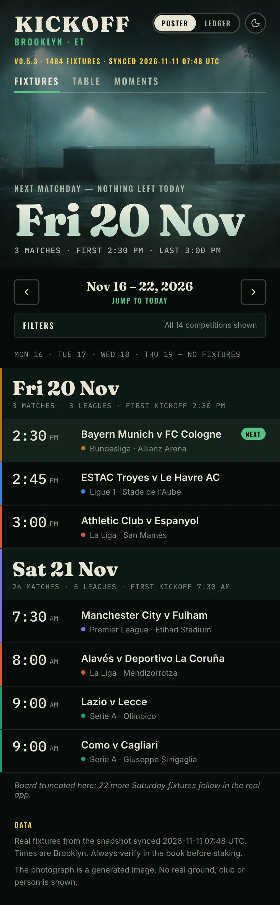
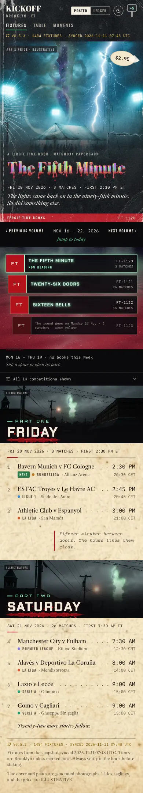
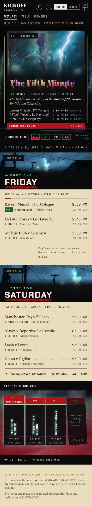
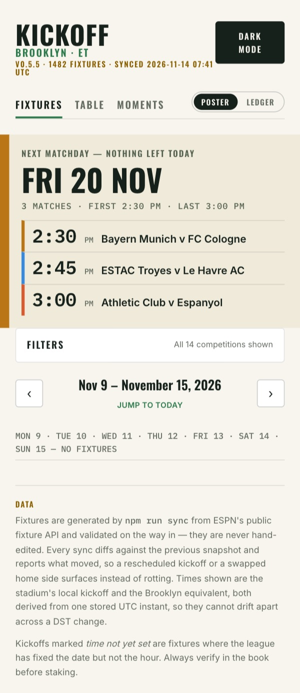
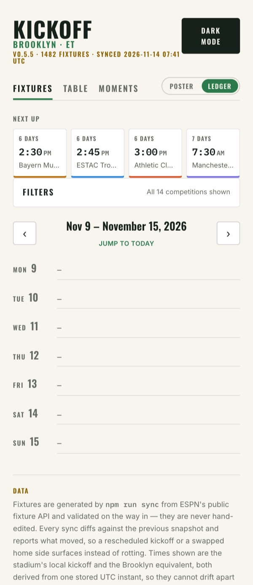
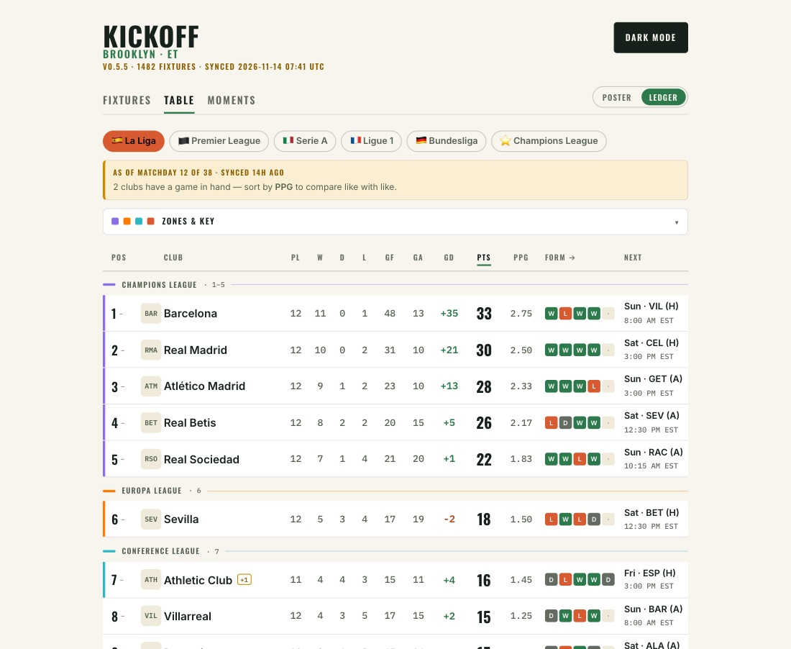
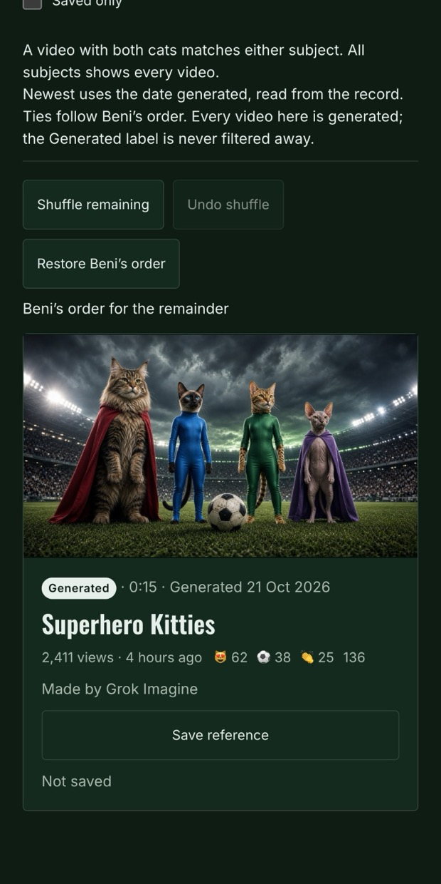
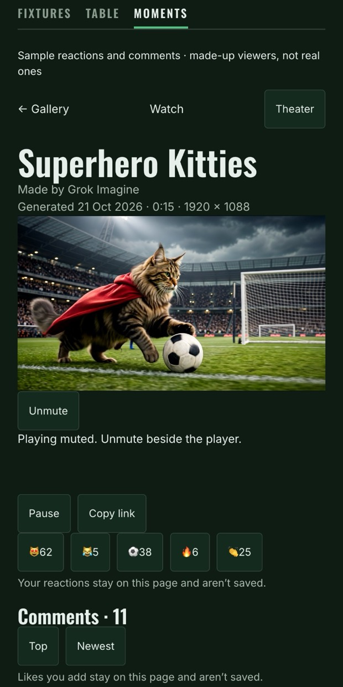
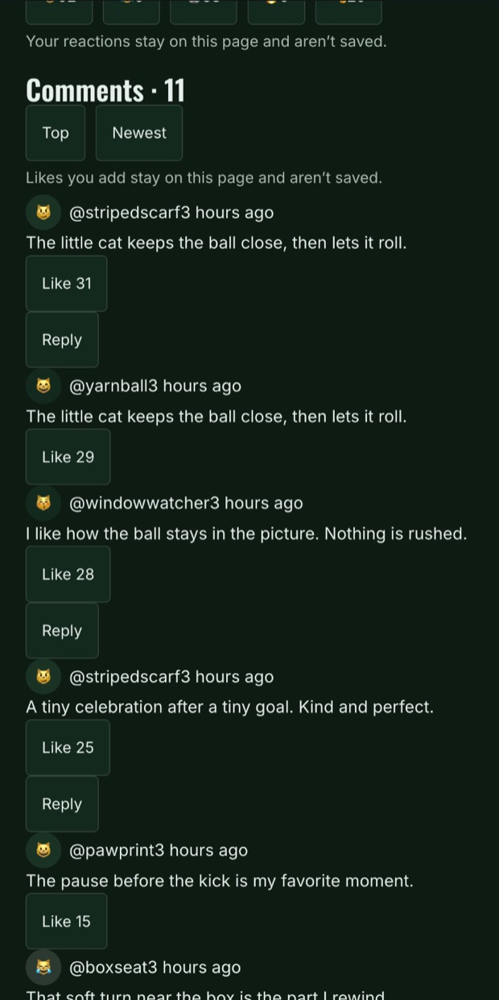
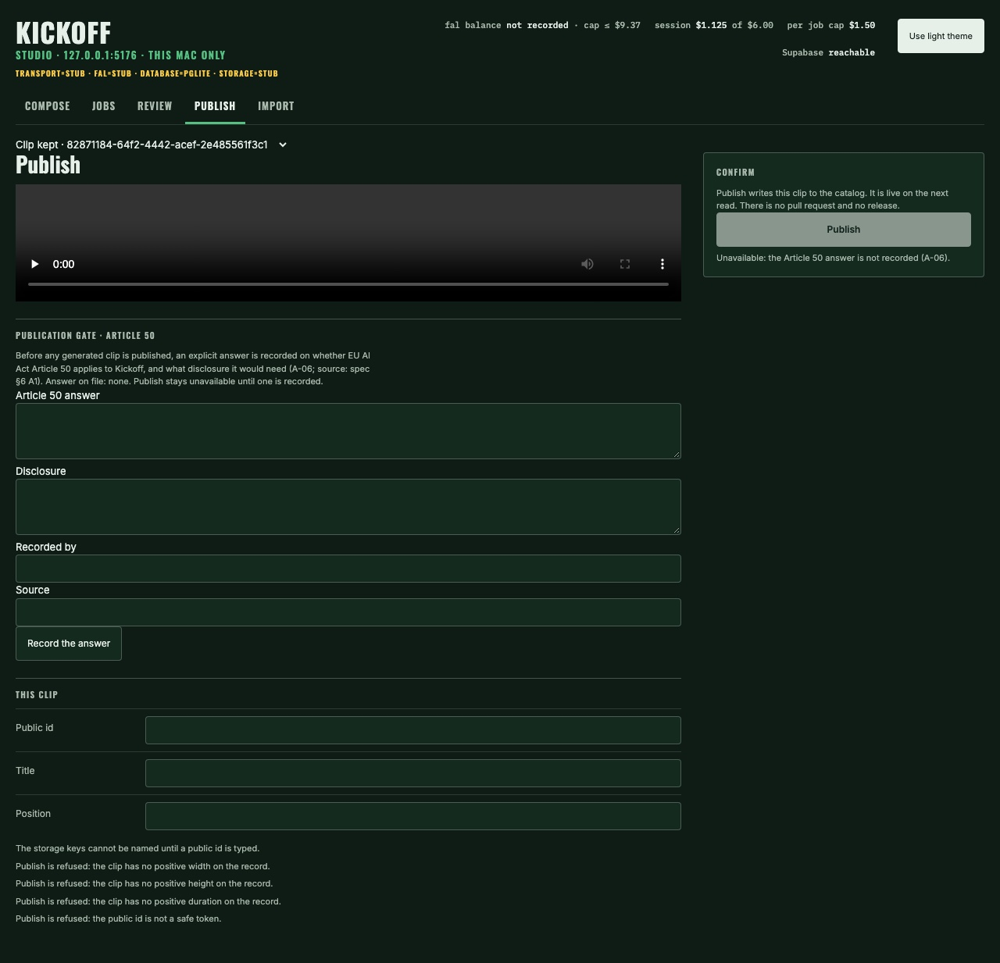

# ⚽ Kickoff

[](https://github.com/BeniCheni/kickoff/actions/workflows/ci.yml)
[](CHANGELOG.md)
[](LICENSE)
[](#-how-it-is-wired)
[](CLAUDE.md)
[](https://openai.com/codex/)
[](docs/moments-player-plan-review.md)

```
╔════════════════════════════╗
║ ╦╔═ ╦ ╔═╗ ╦╔═ ╔═╗ ╔═╗ ╔═╗  ║
║ ║║  ║ ║   ║║  ║ ║ ║   ║    ║
║ ╠╩╗ ║ ║   ╠╩╗ ║ ║ ╠╣  ╠╣   ║
║ ║ ║ ║ ║   ║ ║ ║ ║ ║   ║    ║
║ ╩ ╩ ╩ ╚═╝ ╩ ╩ ╚═╝ ╩   ╩    ║
╠════════════════════════════╣
║ NEVER A CONFIDENT LIE      ║
╚════════════════════════════╝
```

**A football fixtures tracker that would rather admit what it doesn't know than tell you a
confident lie. It grew a video studio that publishes AI-generated cat footballers under the same
rule, and it is about to put on a horror paperback's clothes. It's also an open notebook on how
one person ships software with two AI vendors building and reviewing each other's work.**

You don't need to follow football to read this repo. The football is the excuse. A *fixture* is
a scheduled match, *kickoff* is when it starts, and a *sportsbook* is a betting site that prices
those matches; that is all the jargon you need. The interesting part is the workflow: every line
of the app was written by an AI coding agent. Review depth follows the risk of the change. Every
change but the sync bot's gets a cold read from a different vendor. For sensitive changes, the
builder answers in writing and Beni rules on whatever is still contested.

| If you want | Go here |
|---|---|
| The live demo | **[benicheni.github.io/kickoff](https://benicheni.github.io/kickoff/)** |
| The full-stack app on Vercel *(sign-in required for now)* | **[kickoff-git-main-beni-von-chenis-projects.vercel.app](https://kickoff-git-main-beni-von-chenis-projects.vercel.app/?tab=moments)** |
| The new look *(work in progress)*, and how it was designed | [The look](#%EF%B8%8F-the-look-a-horror-paperback-that-never-existed) and the [design record](docs/design/README.md) |
| How two AI vendors build one repo | [How it gets built](#-how-it-gets-built) |
| Why a fixtures app has a motto | [Why this exists](#-why-this-exists) |
| The map and the data flow | [docs/ARCHITECTURE.md](docs/ARCHITECTURE.md) |

> **The straight answer on what's live.** The demo is the Vite app on GitHub Pages, redeployed
> on every merge. If an amber banner is up when you get there, that's not a bug; that's the whole
> pitch. The full-stack version is a Next.js app on Vercel, still behind Vercel's own sign-in.
> `v0.5.5` is the latest release.

## 🕯️ The look: a horror paperback that never existed

> [!NOTE]
> 🚧 **Work in progress, coming in v0.6.0.** Everything in this section is designed and
> planned, not built yet. The live demo still wears v0.5.5's look until the release ships.

In November I asked for something bigger than a reskin: fixtures and tables with a cosmic horror
atmosphere, photoreal rather than drawn, carrying the pathos and the joy of a bet that comes in.
Within a day the app had a publisher that never existed. By the end of the week it had a design
system for it, and a plan to build it.

```
┌────────────────────────────┐
│ FERGIE TIME BOOKS · FT-1120│
├────────────────────────────┤
│ THE FIFTH MINUTE           │
│                            │
│ The lights came back on in │
│ the ninety-fifth minute.   │
│ So did something else.     │
├────────────────────────────┤
│ FRI 20 NOV · 3 MATCHES     │
│ FIRST 2:30 PM ET           │
└────────────────────────────┘
```

**Fergie Time Books** is a 1980s horror paperback imprint. Every matchday is one of its books, and
the horror is *added time*: the minutes a referee tacks on after the ninetieth, when anything can
still happen. (*Fergie Time* is football slang for added time that seemed to last exactly as long
as Sir Alex Ferguson's Manchester United needed to score. It's also the name of this repo's design
system, so the joke was waiting.) The Poster is the published paperback and the fixtures are its
contents page; the Ledger is the author's typescript; the dark theme is reading under the covers
with a flashlight; the league table is *The Register*. The titles and taglines are fiction. The
date line under them never is.

<p align="center">
  
  &nbsp;
  
  &nbsp;
  
  <br>
  <sub>Wednesday's sketch, Thursday's paperback, Friday's trimmed board. Design boards, not the live app.</sub>
</p>

**How it was made, one tool per seat:**

- 🖊️ **pen.dev was the sketchpad.** Its own AI chat built the boards from paste-ready prompts,
  then I took the wheel, and it came back with five WebGL shaders nobody had asked for: a title
  that bleeds, a day word that bursts, a pool of blood under a torn sky, neon spine titles and a
  faster fog. All five made it into the motion spec.
- 📸 **fal was the darkroom.** Nine of the ten photographs came through three rounds of
  regenerating, regrading and upscaling there, and the tenth came straight from pen.dev. Each
  was looked at by eye, and every fal request was logged.
- 🎨 **Claude Design wrote the second edition** of the *Fergie Time* design system from those
  boards: black cover stock, blood as the alarm voice, three new typefaces, and a layer of
  decorative motion with a single off switch.
- 🔍 **Claude Code reviewed the boards cold** and turned the result into a build plan.
- ✍️ **I edited.** "Develop B." "Trim it": the first match had drifted 1,241 px down the page.
  Then nineteen one-word answers to the plan's questions.

**The horror is allowed to touch everything except the facts:**

- **Live type, never pixels.** Every date, score and clock is real text above the effects;
  nothing burns, drips or glitches on a digit.
- **Amber still means "check this number".** It has exactly eight jobs and none of them is
  decoration, and no photograph is graded warm to borrow its glow.
- **Money is a motif, never a figure.** The pay-out board was cut and fenced.
- **One switch stops all motion,** and a device set to reduce motion starts none.
- **Evoke, never borrow.** Nothing is lifted from the genre's famous novels, not a character,
  town, title or object, and every photograph is captioned ILLUSTRATIVE.

**The plan.** The second edition ships as **v0.6.0**, before the Next.js cutover, in ten pull
requests. The first lands on `main` and changes nothing you can see: it pins the honesty tests the
repaint is not allowed to break. The next eight are reviewed into one integration branch. The last
is the release, so the public site changes once instead of wearing ten half-painted coats. The plan
and its rulings are in [docs/design-overhaul-plan.md](docs/design-overhaul-plan.md); the whole
design week, from the first sketch to Claude Design's handoff, is in
**[docs/design/](docs/design/README.md)**.

---

https://github.com/user-attachments/assets/20449d7e-d1e4-451c-be29-e6a2b15baf38

<p align="center">
  <sub><i>Superhero Kitties</i> · 15 s · made in Grok Imagine, published through the Studio, served from Cloudflare R2.<br>A 720p copy with sound; the published clip is 1920 × 1088.</sub>
</p>

<details>
<summary>Video not playing? Here is a GIF of it.</summary>
<p align="center">
  
  <br>
  <sub>6 fps and 320 px, to keep the repo light.</sub>
</p>
</details>

## 🎲 Why this exists

### Act I · the bets

This repo exists because **Claude and I bet on European football.** (Small stakes, a coin flip
of a sample size, the variance undefeated. Let's not ruin a good story with statistics.)

A bet is a promise about a specific match at a specific time, so it is only as good as the
fixture list under it. Ours ran on a hand-typed HTML dashboard, lovingly maintained and quietly
wrong. When we audited it on 23 August 2026, about twenty rows were false:

```
┌────────────────────────────┐
│ AUDIT SLIP · 23 AUG 2026   │
│ DASHBOARD v. THE LEAGUES   │
├────────────────────────────┤
│ Ligue 1's opening matchday │
│ ............ ONE DAY EARLY │
│ Bundesliga, the opener     │
│ ............ SIX HOURS OFF │
│ A fixture nobody scheduled │
│ ............ DID NOT EXIST │
│ PSG–Rennes, relocated      │
│ ....... WRONG TEAM AT HOME │
├────────────────────────────┤
│ FALSIFIED ROWS .. ABOUT 20 │
│ SLIP ................ VOID │
└────────────────────────────┘
```

The PSG–Rennes line is the one to sit with. The league moved the match to the other team's
stadium, the dashboard kept the old home side, and anyone backing the home team was now backing
the wrong team. None of those were rendering bugs. They were *provenance* bugs, and no model,
however charming, can out-reason a fixture list that lies to it.

So the fix got carved over the door: **fixture data is generated and diffed, never typed.** A
script fetches, validates, snapshots and diffs; a human reads the diff.

### Act II · the second confident lie

Then the repo got a second job, and the lie got better. A wrong kickoff time is a clumsy lie:
anyone can check it against the league. Generated video is a fluent one. A cat in a cape, scoring
under floodlights in a stadium that does not exist, looks like footage until something says
otherwise. So the rule crossed the border into video:

```
┌────────────────────────────┐
│ THE HOUSE RULES            │
├────────────────────────────┤
│ DATA IS GENERATED, DIFFED, │
│ NEVER TYPED.               │
│                            │
│ VIDEO IS GENERATED,        │
│ LABELLED, SIGNED FOR BY A  │
│ HUMAN, AND NEVER PASSED    │
│ OFF AS REAL.               │
└────────────────────────────┘
```

## ⏱️ What it does today (v0.5.5)

### ⚽ The football app (public)

Fourteen competitions: the five big domestic leagues of Spain, England, Italy, France and
Germany, the three European club cups, and six one-off super cups. 1,482 fixtures and six league
tables as of 14 November 2026, synced from ESPN's public scoreboard and shown through two
*lenses* over one fixture list: **Poster**, big and loud, and **Ledger**, dense and fast. The
pictures are the v0.5.5 build at a phone's 390 px width, and a league table at desktop width.

<p align="center">
  
  &nbsp;
  
</p>

What the app refuses to do is the feature:

- **Two clocks from one instant.** Every kickoff is stored once, as a UTC instant. The stadium
  clock and the Brooklyn clock are both derived from it, so they cannot disagree.
- **Unknowns stay unknown.** A kickoff the league hasn't set reads "not yet set". A stadium
  whose time zone isn't known reads "local time not known". Nothing is guessed to look tidy.
- **Every sync is diffed.** A moved date, a changed kickoff, a swapped home side, a vanished
  fixture, a corrected score: each is named in the pull request the sync opens.
- **Staleness is a state.** The header says when the data was synced; a banner turns amber at a
  day old and red at three.
- **The table says what it can't compare.** "2 clubs have a game in hand — sort by PPG."

<p align="center">
  
</p>

The full argument is in **[docs/HONESTY.md](docs/HONESTY.md)**.

### 🎬 Moments: the generated-video gallery (full-stack, unreleased)

Moments is the third tab, and it is where the video lives: a gallery of AI-generated clips built
around two cats, Fenway and Frankenstein, with a watch page, a "Similar moments" rail and a
saved list that stays in your browser. Every card carries a `Generated` badge that no filter can
hide.

```
╔════════════════════════════╗
║ TEAM SHEET · MOMENTS       ║
╠════════════════════════════╣
║ AS A VIEWER I CAN          ║
║  1 open a gallery where    ║
║    every clip says it was  ║
║    generated               ║
║  2 watch one, muted first, ║
║    and unmute when I like  ║
║  3 find similar moments    ║
║  4 poke the reactions and  ║
║    read the comments       ║
║    (made up, and it says)  ║
╠════════════════════════════╣
║ AS THE CURATOR I CAN       ║
║  1 import a Grok Imagine   ║
║    clip                    ║
║  2 walk the five-point     ║
║    check, line by line     ║
║  3 sign the Article 50     ║
║    answer in my own words  ║
║  4 press Publish           ║
╚════════════════════════════╝
```

<p align="center">
  
  &nbsp;
  
  &nbsp;
  
</p>

**The crowd is cardboard, on purpose.** The reactions, view counts and comments are written by
the database from fictional viewers, every row is flagged `synthetic`, and the page says so
wherever they show. They exist to design social features against, not to suggest an audience.

**Nothing publishes itself.** Every clip comes through the Studio, a local admin that runs on one
Mac: it reads the file's own facts, strips its metadata, asks five questions that all have to come
back Clear, and keeps the Publish button disabled until a written answer under Article 50 of the
EU AI Act (the transparency duty for AI-generated content) is on file. The database enforces the
same gate a second time, so a bug in one cannot publish what the other would refuse. At the
whistle it prints where the clip went, so a fallback can't pass for the real thing:

```
┌────────────────────────────┐
│ FULL TIME                  │
│ published live=true        │
│ database=postgres          │
│ storage=r2                 │
│ embedding=written          │
└────────────────────────────┘
```

<p align="center">
  
  <br>
  <sub>The Studio's own stub-mode proof run: a fictional clip and a local database, so this is the interface and not the live catalog.</sub>
</p>

## 🧱 How it is wired

| Piece | What it is |
|---|---|
| `src/` | The public app: Vite + React 19, static, on GitHub Pages |
| `web/` | The reader: Next.js 16, on Vercel, behind Vercel Authentication |
| `studio/` | The admin and CLI: Node, Drizzle, `@huggingface/transformers`, PGlite for tests |
| `packages/` | `@kickoff/catalog` (the public row contract) and `@kickoff/demo` (the sample layer) |
| Supabase · R2 | Postgres with pgvector for the catalog and its CLIP vectors · Cloudflare R2 for video and thumbnails |

The delivery pipeline is boring on purpose: `verify` is the one required check, and every
Vercel deployment is smoke-tested against its own commit and snapshot. The step-by-step setup is
in [`web/README.md`](web/README.md) and [`studio/README.md`](studio/README.md).

## 🤖 How it gets built

This is the part I'd read first if I weren't a football person.

**Nobody types the code.** As of 14 November 2026 the repo has merged 316 pull requests: 226
opened by the scheduled data sync, which merges its own once CI is green, and 90 features, fixes
and docs, every one written by a coding agent under a written spec. The public app carries 981
passing tests.

**Every version climbs a ladder of up to four documents**, all archived in
[`docs/`](docs/README.md): a *proposal* (an audit of the repo plus directions), a *design brief*,
a *build spec* and a *review prompt*, each generated from a fresh read of the repo, never from
anyone's memory of it.

Since 22 November 2026, a pull request takes the highest tier its changes reach. A PR the
scheduled sync workflow opens from `sync/scheduled`, containing only `src/data/**` and
`docs/sync-digest.md`, takes Tier 0. On eligible PR events, the `tier` workflow computes the
tier from the default branch's [Tier 3 list](AGENTS.md#tier-3-paths). Forks get a summary only.
The workflow applies existing repository labels to same-repo PRs, never lowers the tier, and
preserves manual tier-label changes. The builder still names the tier and the file that sets it
in the PR body. Any reviewer can raise the tier. Only Beni can lower it.

| Tier | Changes | Review and merge |
|---|---|---|
| 0 · Generated | Scheduled sync PRs as described above | The workflow merges after `verify` passes. |
| 1 · Docs | Prose in `docs/` or this README, outside Tier 3 | One cold read by the other vendor, then Beni merges. A planned automated read will run only on branches in this repo. |
| 2 · Code | App or tooling code, and anything no other tier covers | One report-only cold read by the other vendor. The builder fixes findings. |
| 3 · Sensitive | Data honesty, sync, workflows, schema, clocks, standing agent instructions, releases and numbering | The six-pass 360, with the merge on Beni's word. |

The Tier 2 reviewer runs `/kickoff-pr-review`, re-reads each round, and merges only on
“Mergeable now” with `verify` green at the tip.

[AGENTS.md](AGENTS.md#review-tiers) lists the Tier 3 paths. Beni merges and tags every release.

**Tier 3 gets the six-pass 360.**

| Pass | Who | What they leave behind |
|---|---|---|
| 0 · Brief | The seat that briefs the review | The review prompt, with the builder's claims sealed in an appendix marked "verify independently" |
| 1 · Cold review | The vendor that did **not** build it | Findings it reproduced, one PR comment |
| 1.5 · Rebuttal brief | The seat that briefs the review | Each finding packaged for the builder to accept, contest, or accept-but-contest-the-characterisation |
| 2 · Rebuttal | The builder | Its answers, in code |
| 2.5 · Synthesis | A seat that wrote neither the build nor the fixes | Every number re-run at the tip, and a merge gate |
| 3 · Adjudication | A human | Rules on whatever is still contested, and gives the word to merge |

Why bother with a rebuttal? Because on the first full run the builder overturned the reviewer on
a live technical claim: the reviewer said a malformed team id "can only miss the join"; the
builder reproduced the opposite, one team borrowing another's league position, and fixed it. One
reviewer would have merged that.

**Codex is the default builder as of 22 November 2026.** Claude builds when Beni routes a PR to
it. In both columns below, Pass 1 reports findings and the builder commits the fixes.

| Seat | When Codex builds (default) | When Claude builds |
|---|---|---|
| Product manager / scoping / build brief | Claude (Cowork, then Claude Code) | Claude (Cowork, then Claude Code) |
| Passes 0 and 1.5 | The PM seat | Codex (GPT-6.2 Astra) |
| Build, Pass 2 and fix rounds | Codex (GPT-6.2 Sol or Astra, as briefed) | Claude Code (Opus 5.5) |
| Pass 1 · Cold review | Fresh Claude Code session (Fable 5.2), report-only | Fresh Codex session (GPT-6.2 Astra), report-only |
| Pass 2.5 · Synthesis | Fresh Claude Code session (Opus 5.5), writes nothing | Fresh Codex session (GPT-6.2 Sol), read-only |
| Designer | Claude Design against *Fergie Time*, using pen.dev | Claude Design against *Fergie Time*, using pen.dev |
| CEO / Pass 3 | Beni adjudicates and gives the word to merge | Beni adjudicates and gives the word to merge |

**Verification is measured, never admired.** A review is not "it looks fine". It's 96 browser
cells across two apps, three tabs, two lenses, two themes and four widths, each checked for
sideways overflow; a fix reproduced red against the commit before it and green after. Screenshots are set
to a viewport before capture, because one clipped screenshot once cost a whole review pass
proving a bug that didn't exist. The repo skills that encode all this:
[`/kickoff-pr-review`](.claude/skills/kickoff-pr-review/) for cold review and the Tier 3 cycle, and
[`kickoff-design-studio`](.agents/skills/kickoff-design-studio/) and
[`kickoff-design-review`](.agents/skills/kickoff-design-review/) for design.

## 📍 Where we are

**Shipped, and public** (`v0.5.5`): fixtures, standings, the two lenses, the scheduled sync with
its self-merging pull requests and change digest, and the Champions League with computed matchday
provenance and venue clocks.

**Next: the second edition, as v0.6.0.** The first build brief (the tests-only pull request) and
a design pass for two screens the boards never drew (the filter panel and the league key, opened)
were written on 14 November.

**Built, not yet released.** The full-stack work lands without a version until the cutover: the
Studio and its Supabase schema, Grok Imagine import, R2 storage and the publish gate; the Next.js
reader with Fixtures, Table and the Moments gallery, compared pixel by pixel against the public
app; CLIP similarity through pgvector; and a Vercel preview that smoke-tests itself.

**Parked.** The rest of the Moments and Studio work, a privacy page among it, waits while I
rethink the viewer's journey. The cutover that makes the Next.js app the public one follows the
second edition. The steps are in [docs/nextjs-migration-plan.md](docs/nextjs-migration-plan.md).

## 🥅 Try it

The [demo](https://benicheni.github.io/kickoff/) needs nothing. To run it yourself you want Node
24 (24.15 or later; 22.22.2 or later 22.x, or any 26+, also clears jsdom 30's floor):

```bash
npm install
npm run dev
npm test
npm run typecheck
npm run build
npm run sync -- --check
```

The dev server hot-reloads at `localhost:5173`. Vitest checks the pure layer under Node and
component wiring under jsdom. The build writes to `dist/`. The sync check fetches ESPN and diffs
against the snapshot without writing it.

The fixture snapshot is committed, so the app works offline from a clone. `npm run sync`
refreshes it from ESPN's public scoreboard (no key, no account) and writes to the repo, so read
[the commands](docs/ARCHITECTURE.md#commands) first. The full-stack half needs accounts and keys,
so it is a runbook rather than a quick start: [`web/README.md`](web/README.md) and
[`studio/README.md`](studio/README.md).

Lens, tab, week and filters all live in the URL (`?lens=ledger&tab=table` means what it says), so
any view survives a reload and can be sent to someone. Found a fixture the app gets wrong? That's
this repo's signature issue; there's a
[template](.github/ISSUE_TEMPLATE/wrong-fixture-data.md).

## 🏆 Lineage

One subject line per release. The honours board:

- **v0.5.5** *(Sat 14 Nov 2026)* — the clearing: the Broadcast lens, Where to Watch and the Monthly view are retired, and the fixtures start higher on the page.
- **v0.5.4** *(Sat 14 Nov 2026)* — a match decided in extra time or on penalties is stored as its own final, so one such result can no longer refuse the snapshot for every league.
- **v0.5.3** *(27 Oct 2026)* — one suspended or abandoned match can no longer freeze every league's table.
- **v0.5.2** *(17 Sep 2026)* — hotfix to the hotfix: the 30-day lookback restored so the app keeps its recent results.
- **v0.5.1** *(17 Sep 2026)* — hotfix: ESPN's date-range API broke; the sync switched to day-by-day fetching.
- **v0.5.0** *(12 Sep 2026)* — the Champions League joins the schedule: 144 league-phase fixtures, matchday provenance, venue clocks with honest unknowns, a 36-club table, and Moments as an empty-first third tab.
- **v0.4.1** *(12 Sep 2026)* — the small print tells the truth too: every sync warning and red-run outcome says what actually happened.
- **v0.4.0** *(11 Sep 2026)* — the sync tells the whole truth: corrected scores and team identities reported, quiet checks publish verified freshness.
- **v0.3.2** *(9 Sep 2026)* — the sync's verify step survives a live match.
- **v0.3.1** *(8 Sep 2026)* — the Table tells the time like every other lens; the sync merges itself once `verify` is green.
- **v0.3.0** *(6 Sep 2026)* — snapshot states say what is known; the six-pass review cycle is born.
- **v0.2.5** *(5 Sep 2026)* — the resilience patch: fixtures and standings publish together, failed views recover.
- **v0.2.4** *(5 Sep 2026)* — tests reach the wiring: a jsdom project beside the node suite.
- **v0.2.3** *(4 Sep 2026)* — a hotfix: workflows on Node 24.
- **v0.2.2** *(4 Sep 2026)* — the front door: Poster by default, a hero that tells the time, these docs.
- **v0.2.1** *(3 Sep 2026)* — the review becomes a command.
- **v0.2.0** *(2 Sep 2026)* — the app learns to tell time: a clock that ticks, a sync that fails loudly, a scheduled refresh that opens its own PR.
- **v0.1.1** *(1 Sep 2026)* — the public-repo milestone: security sweep, license, CI.
- **v0.1.0** *(31 Aug 2026)* — the lens system: Ledger, Poster, Broadcast over one skeleton.
- **v0.0.2** *(26 Aug 2026)* — the Table: full standings synced from ESPN.
- **v0.0.1** *(23 Aug 2026)* — the rewrite: generated-and-diffed data replaces the hand-typed dashboard.

Every proposal, design brief, build spec and review prompt behind those lines is indexed in
[docs/README.md](docs/README.md). The design system they're built against, *Fergie Time* (yes,
really), is still in the tunnel; its second edition's record is already on the pitch in
[docs/design/](docs/design/README.md).

## ⚖️ License and the small print

[MIT](LICENSE), with one exception: the design boards and photographs under `docs/design/` are
generated or contain generated images, and carry [their own notice](docs/design/LICENCE.md)
instead. Not betting advice: the only edge this repo guarantees is a correct kickoff time. If you
do bet, be of legal age, in a legal market, with money you can afford to lose. The variance is
undefeated.

The generated video is AI-made and labelled as such; so are the reactions and comments beside
it. The stack choices (Next.js, Drizzle, Supabase, pgvector, CLIP, Cloudflare, Vercel) follow the
shape of ByteByteGo's *Rebuild YouTube with AI* course. Its reference repo declares no licence, so
patterns were studied and no code was copied.
