# 🕯️ The design record: how Kickoff became a horror paperback

Between Wednesday 11 and Saturday 14 November 2026, Kickoff's look went from a tidy fixtures list
to *Fergie Time Books*: a 1980s horror paperback imprint that never existed, where every matchday
is a book and the horror is added time. This folder is that week, stage by stage, as the boards
looked when each decision was made.

Four tools did the drawing, each in the seat it suited:

- **pen.dev** is the sketchpad: an infinite canvas with its own AI chat and an image generator,
  where the boards were built and argued over.
- **fal** is the darkroom: the photographs were regenerated, regraded and upscaled there, one
  logged request at a time.
- **Claude Design** wrote the second edition of the *Fergie Time* design system from those
  boards: tokens, voices, type, components and motion contracts.
- **Claude Code** reviewed the boards cold, wrote every prompt, and turned the result into a
  build plan.

Beni ruled at every fork, and the rulings are in
[`../design-overhaul-proposal.md`](../design-overhaul-proposal.md).

**What is here:** board exports as WebP previews, the ten photographs as picked, the 14 shaders,
and the handoff texts. **What is not:** the `.pen` files, which only pen.dev opens and which link to
about 280 MB of images by path; the full-size photographs and every rejected generation; the
Claude Design canvas; and one board, B7, a pay-out concept that ruling D6 fenced out until bets are
tracked. The images are under their own notice, [`LICENCE.md`](LICENCE.md), not MIT.

## 1 · Night Fixture, Wed 11 Nov · [`1-night-fixture/`](1-night-fixture/)

The brief was fixtures and tables with a cosmic horror atmosphere: photoreal rather than drawn,
carrying the pathos and the joy of a bet that comes in. The first canvas drew three answers on real
fixtures:

- **A, Night Fixture** (recommended): a photograph behind each hero and a flat plane for the data.
- **B, The Paperback:** each matchday a worn horror paperback.
- **C, The Window:** one continuous scene, a bookmaker's shop after closing.

Beni overruled the recommendation the same day: *develop B, more cosmic horror, no aesthetic
boundaries.*

  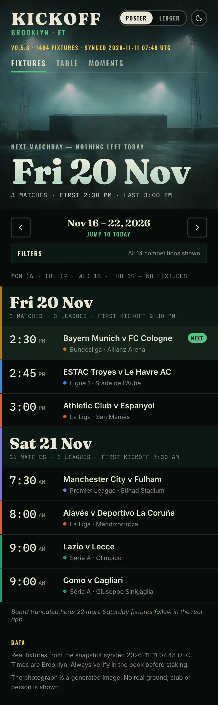
  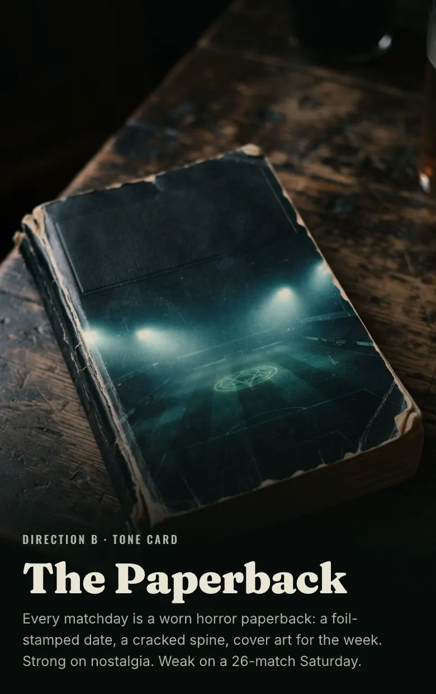
  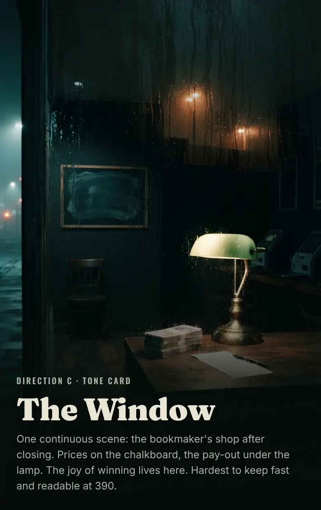

## 2 · The Paperback, Wed 11 – Thu 12 Nov · [`2-the-paperback/`](2-the-paperback/)

B became a world. Poster is the published paperback, with the fixtures as its contents page; the
Ledger is the author's typescript; the dark theme is reading under the covers by flashlight; the
Table is *The Register*. Beni ran the first prompt in pen.dev's own chat and then steered it
himself, and B0, the world bible, came back with five shaders nobody had asked for: a title that
bleeds, a day word that bursts, a pool of blood under a torn sky, neon spine titles and a faster
fog. The cover-price stickers, a period joke, were retired later.

  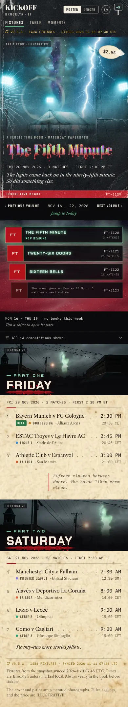
  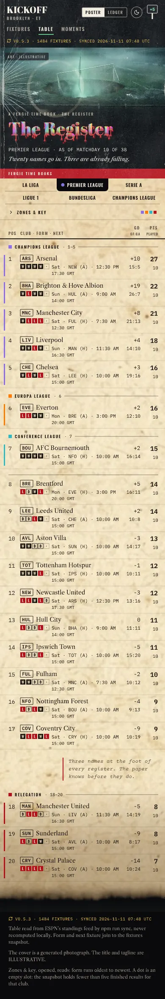
  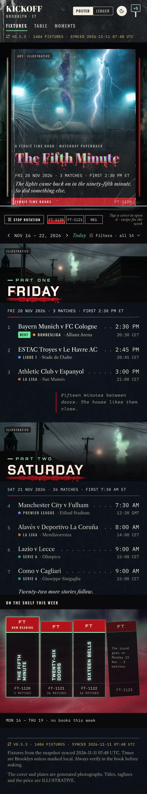

## 3 · The trim, Thu 12 – Fri 13 Nov · [`3-the-trim/`](3-the-trim/)

The covers were gorgeous and the first match sat 1,241 px down the page, against 856 px on the
live site. Beni ruled *trim it*: the cover stays full size, the shelf of spines moves below the
contents, and the target was about 850 px. B9 wrote down every motion as a timed contract with a
still for when motion is off.

  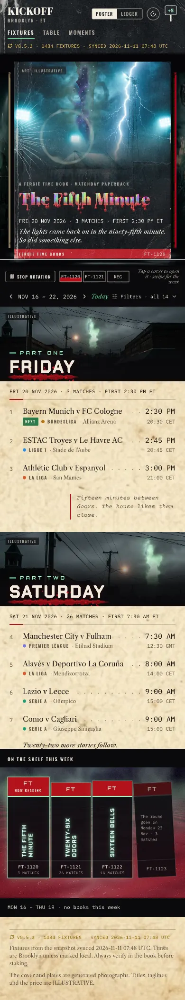
  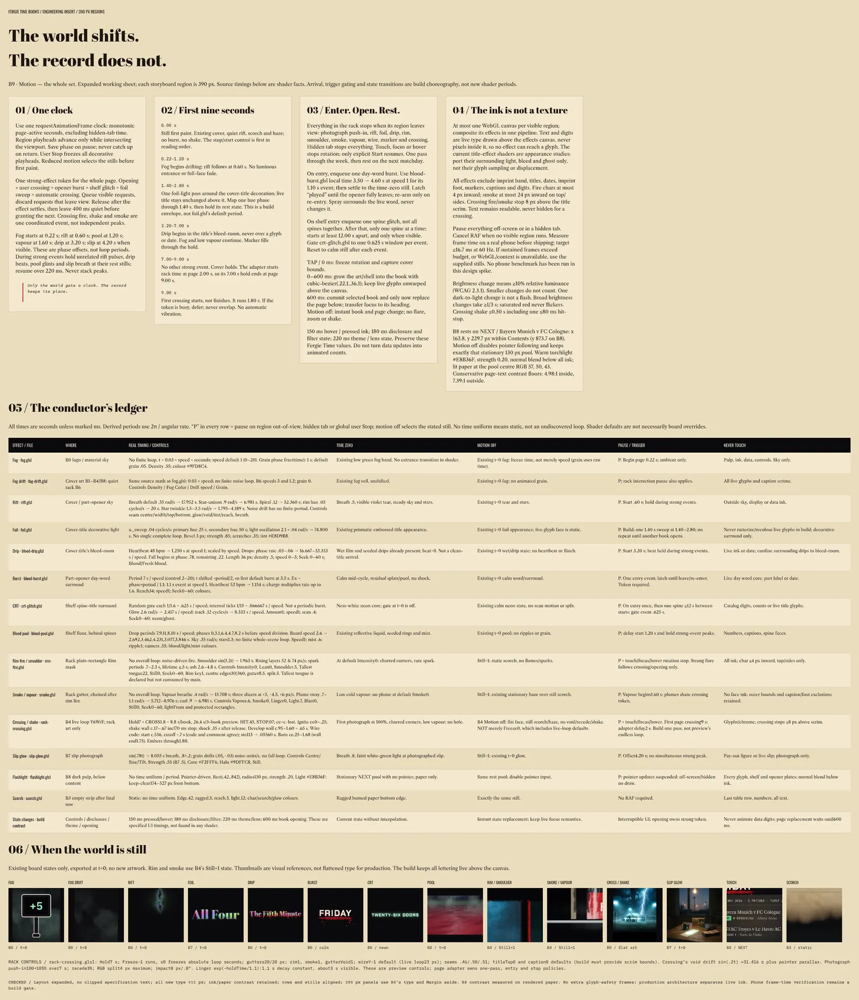

## 4 · The photographs, Fri 13 Nov · [`4-photographs/`](4-photographs/)

Nine photographs came through three rounds on fal. The tenth, the void, came straight from pen.dev.
The picks were looked at by eye. The rules: evoke, never borrow; no real ground, club, crest,
kit or person; and nothing warm, because amber is reserved for data you should check. Seven began
in pen.dev's Generate, which does not record its model, so their record says "not recorded"
(Beni's ruling, 14 Nov). Every request is in
[`5-handoff/fal-provenance.jsonl`](5-handoff/fal-provenance.jsonl), without costs or download
links.

  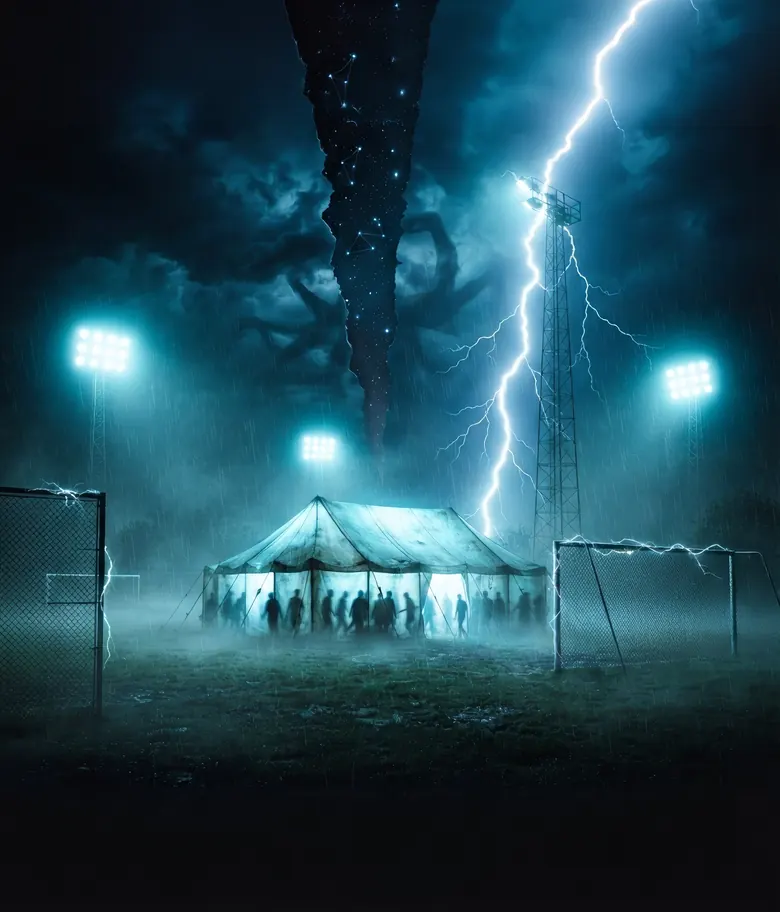
  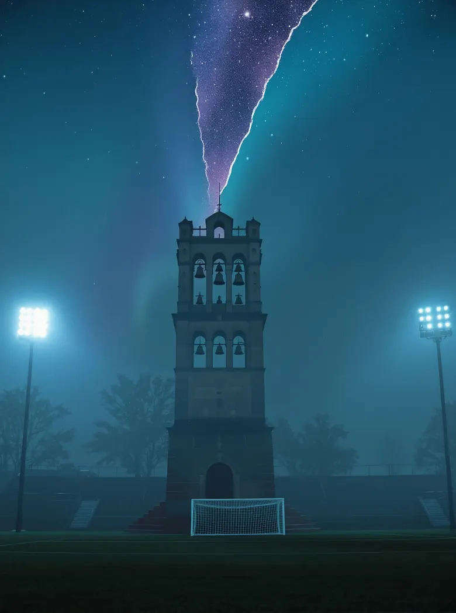
  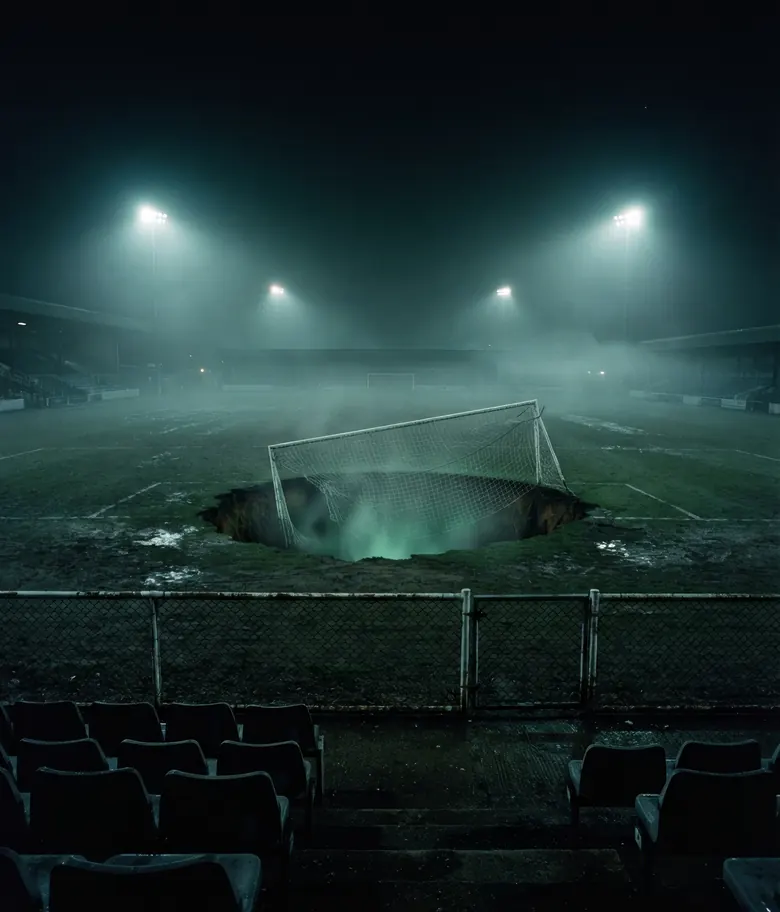
  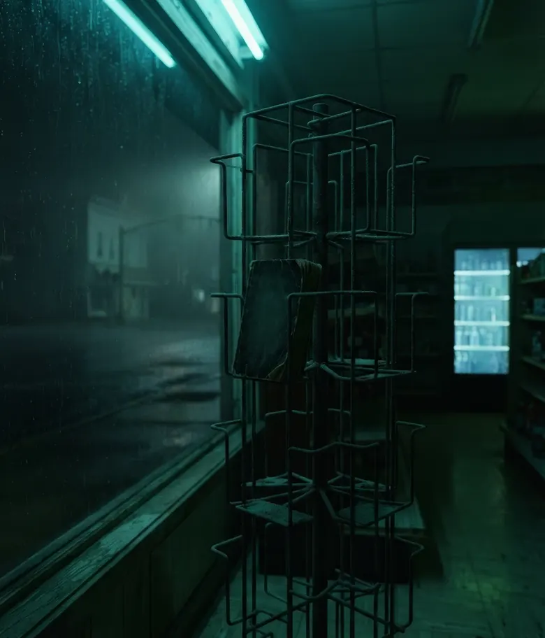

## 5 · The handoff, Fri 13 Nov · [`5-handoff/`](5-handoff/)

Claude Code reviewed the trimmed boards cold, and Beni ruled its decisions, D2 to D14, that
evening. Then the boards went to Claude Design, which wrote the second edition, and a fix pass
folded in Beni's review of it: [`second-edition-handoff.md`](5-handoff/second-edition-handoff.md).
It adds black cover stock, blood as the alarm voice, three new type families and a separate layer
of decorative motion with one stop control. It keeps the first edition's honesty intact: text stays
live type above every effect, amber has exactly eight uses, and every stadium clock reads "20:30
local". The rules the boards were drawn under are in [`rules-note.txt`](5-handoff/rules-note.txt).
On Tue 17 Nov Claude Design drew gap 18 (the filter panel, and Zones & key, opened), Beni ruled
its questions 22 to 26, and the folded addendum is in [`gap-18-addendum.md`](5-handoff/gap-18-addendum.md).
It is the later word on every section it names. Later that day a rows pass redrew KICKED OFF and the
unsettled row, Beni ruled 27 to 29, and the same file closes with the handoff's changed lines and its
final section 11.

## 6 · The plan, Sat 14 Nov

The second edition is built before the Next.js cutover, as ten pull requests: one on `main` that
pins the honesty rules and changes nothing a reader sees, eight reviewed into an integration
branch, and one release, **v0.6.0**, so the public site changes once. The plan, its scoring and
Beni's nineteen answers are [`../design-overhaul-plan.md`](../design-overhaul-plan.md) and
[`../design-overhaul-plan-review.md`](../design-overhaul-plan-review.md).

## The shaders · [`shaders/`](shaders/)

Fourteen WebGL 1 fragment shaders, as written on the canvas: `fog`, `fog-drift`, `rift`, `foil`,
`blood-drip`, `blood-burst`, `blood-pool`, `crt-glitch`, `flashlight`, `rim-fire`, `smoke`,
`scorch`, `rack-crossing`, and `slip-glow`. The archive includes `slip-glow` as a sketch.
Its use in the app remains fenced with the pay-out board. The build will make its own shaders.
